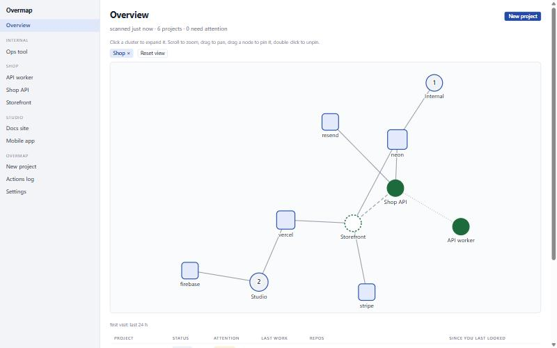
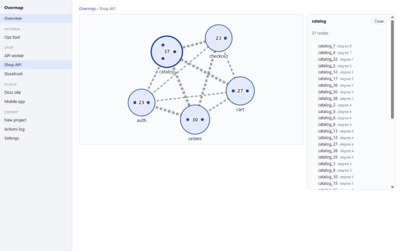
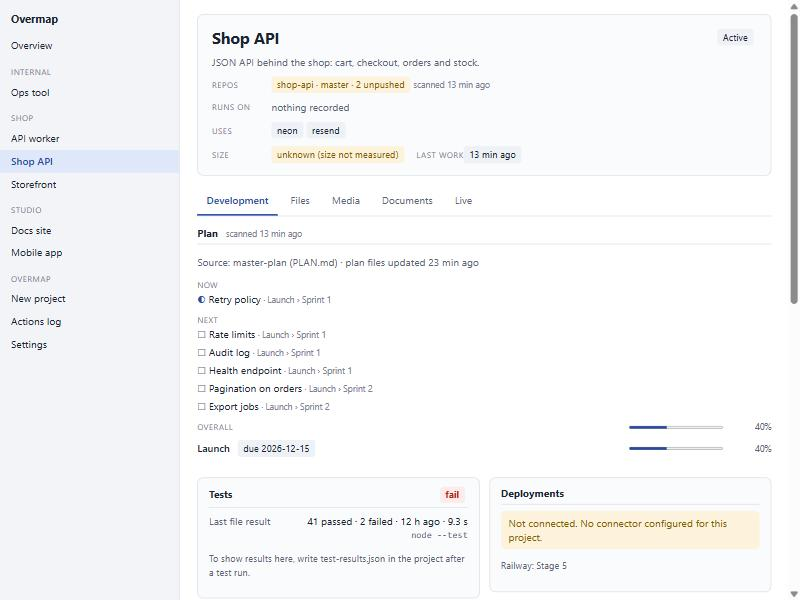

# Overmap

Overmap is a map of every project you build with Claude Code: which folder it lives in, what it deploys to, what shares a service with what, what is half-done, and what inside a project talks to what. Projects are clustered by group, shared services are hubs, and zooming into a project shows its Graphify communities. Facts come from git, `PLAN.md`, `test-results.json` and a few connectors; the registry is your Obsidian notes.



Zero dependencies. Node 22+. Every file is readable.

## Quick start

You need Node 22 or newer (Overmap uses the built-in `node:sqlite`). Then:

```
git clone https://github.com/tommypj/overmap.git
cd overmap
node serve.mjs --sample
```

Open http://127.0.0.1:3210. The sample is six invented projects in a temporary folder, removed when the server stops, so the map has something to show before you point Overmap at your own work.

To use your own projects, build an instance folder and point Overmap at it:

```
node make-registry.mjs --home ~/.overmap
```

The first run creates `~/.overmap/overmap.config.json`. Set `vaultProjectsDir` to the folder that holds your project notes (see [docs/notes.md](docs/notes.md)), then run the same command again. Until `vaultProjectsDir` in `overmap.config.json` points at a folder that exists, `make-registry.mjs` prints one line naming the folder and exits. That first-run failure is expected, not a bug. Run `make-registry.mjs` again whenever you edit a note: it refreshes the fields the note owns. After that:

```
node scan.mjs --home ~/.overmap
node serve.mjs --home ~/.overmap
```

On Windows PowerShell, use `--home "$env:USERPROFILE\.overmap"`. You can also set `OVERMAP_HOME` instead of passing `--home`; the order is `--home`, then `OVERMAP_HOME`, then `~/.overmap`. Once the server runs, it rescans every 15 minutes and at 04:00 each day; `--no-schedule` turns that off.

## Zoom in



Click a project to zoom in on its Graphify communities, god nodes and their links. Escape zooms back out. The Dev tab lists the same project's repos, worktrees, plan progress, tests and deploys.



## What it reads

- **Notes** in your Obsidian vault, one per project. The notes are the registry: a note with `dashboard: true` is listed. Folders without a note can go in `registry.extra.json`.
- **Graphify** output, `graphify-out/graph.json` in each project home. Overmap reads it; it never runs Graphify during a scan. See [docs/graphify.md](docs/graphify.md).
- **Git**: branch, ahead and behind, modified and untracked files, for every repo and worktree.
- **`PLAN.md`** progress, and `test-results.json` from your last test run. See [docs/hook.md](docs/hook.md) for both formats.
- **Connectors**: six worked examples (Vercel, Search Console, GA4, Sentry, Lemon Squeezy, HTTP health). See [docs/connectors.md](docs/connectors.md).

A scan writes only inside its instance folder, plus the two files you name in the config (an architecture file and a vault status table). The web actions are a rescan, Ask the graph (read-only), and creating a new project, which makes a folder and a note.

## The Stop hook

Claude Code can end a session without updating anything, so the progress numbers go stale. The Stop hook stops that: when a session changed a registered project and its plan was not touched, the hook blocks the stop once and asks Claude to tick what it finished. It never blocks by mistake; any error, timeout or unknown folder lets the session stop.

Add it to `~/.claude/settings.json`, with the paths quoted and `<overmap>` and `<dir>` replaced by your checkout and instance folder:

```json
"hooks": {
  "Stop": [
    {
      "hooks": [
        { "type": "command", "command": "node \"<overmap>/hooks/plan-check.mjs\" --home \"<dir>\"", "timeout": 10 }
      ]
    }
  ]
}
```

`--home` is optional; without it the hook reads `OVERMAP_HOME`, then `~/.overmap`. Details, the `PLAN.md` format and hand tests are in [docs/hook.md](docs/hook.md).

## Notes

A project is a Markdown note with frontmatter (`type: project`, `dashboard: true`, `path`, and optional `name`, `status`, `group`, `repos`, `deploy`, `uses`, `connects`, `links`), plus an optional `## Blockers` list. [docs/notes.md](docs/notes.md) has every field and a worked example.

## Connectors are examples

The six connectors are worked examples, not a promise. They show how to read a service, mask its secrets and record facts; the maintainer does not run them against every service. Secrets live in `secrets.json` in your instance folder, which Overmap refuses to read unless only you can read it. Writing your own is covered in [docs/connectors.md](docs/connectors.md). Contributions are welcome.

## Phone access

Overmap listens on loopback only. To open it on a phone, put a proxy such as Tailscale Serve in front of it, let the proxy send your identity and HTTPS headers, and name your login in the config. See [docs/phone.md](docs/phone.md).

## Privacy

The public tree must not contain anyone's paths, hosts, names or secrets. `tools/publish-check.mjs` scans for drive-letter paths, user folders, tailnet hostnames, email addresses and token shapes; set `OVERMAP_DENYLIST` to a file of your own terms to scan for those too. The same scan runs as a test. Run it before you push:

```
OVERMAP_DENYLIST=<your-denylist> node tools/publish-check.mjs .
```

## Tests

```
node --test "test/*.test.mjs"
```

## Documentation

- [docs/notes.md](docs/notes.md): the project note format and the registry files
- [docs/graphify.md](docs/graphify.md): what Overmap reads from Graphify and how to produce it
- [docs/hook.md](docs/hook.md): the Stop hook, the `PLAN.md` format and `test-results.json`
- [docs/connectors.md](docs/connectors.md): the connectors, their secrets and settings, and how to write one
- [docs/phone.md](docs/phone.md): loopback, identity headers and Tailscale Serve
- [CONTRIBUTING.md](CONTRIBUTING.md) and [SECURITY.md](SECURITY.md)

## License

MIT. See [LICENSE](LICENSE).
